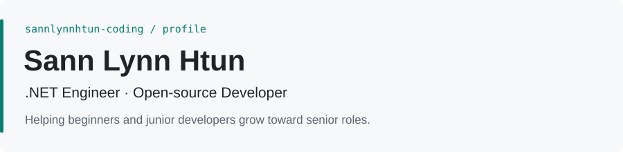
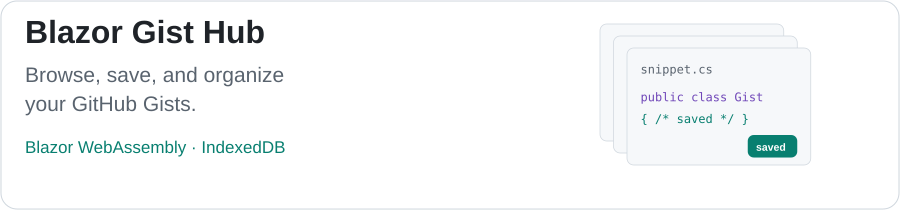
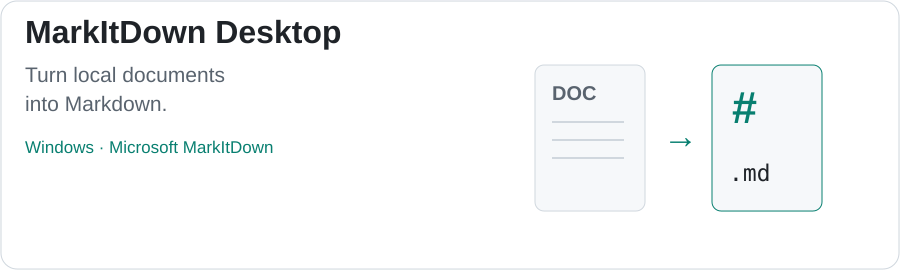
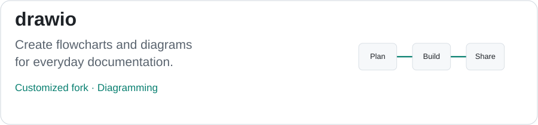
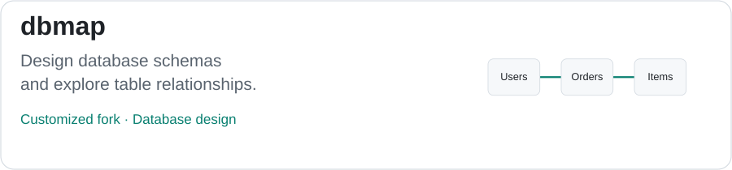
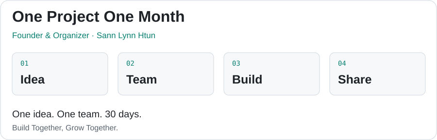
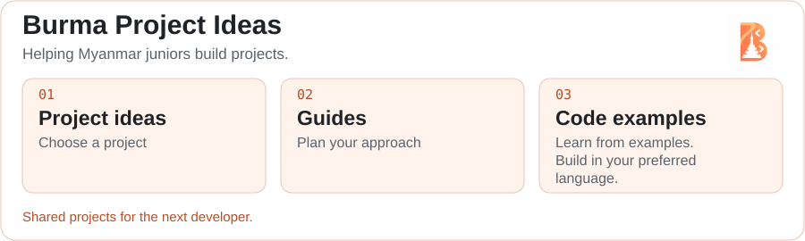
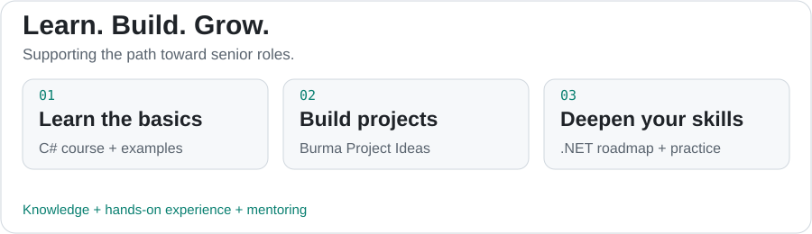

<picture>
  <source media="(max-width: 600px)" srcset="assets/profile-mobile.svg">
  <source media="(prefers-color-scheme: dark)" srcset="assets/profile-dark.svg">
  
</picture>

[LinkedIn](https://linkedin.com/in/sannlynnhtun) · [YouTube](https://www.youtube.com/@SannLynnHtun) · [Facebook](https://fb.com/sannlynnhtun-coding) · [Telegram](https://t.me/+SnO5wIMP8QRhYmZl)

> We live. We code. We yoke.

I build banking and financial software with C# and .NET, and lead development teams at [ACE Data Systems](https://acedatasystems.com/). I have worked in software since 2015.

I am the **Founder & Organizer of [One Project One Month](https://one-project-one-month.com/)**, a community where teams build one project in 30 days. I build open-source tools and help beginners and junior developers deepen their knowledge, gain practical experience, and grow toward senior developer roles through C# classes and mentoring.

## Open-Source Projects

<a href="https://github.com/sannlynnhtun-coding/blazor-gist-hub">
<picture>
  <source media="(max-width: 600px)" srcset="assets/gist-hub-mobile.svg">
  <source media="(prefers-color-scheme: dark)" srcset="assets/gist-hub-dark.svg">
  
</picture>
</a>

A Blazor WebAssembly app for browsing, creating, and organizing GitHub Gists, with local caching, bookmarks, and collections. 
[Live demo](https://gist-hub.vercel.app/) · [Repository](https://github.com/sannlynnhtun-coding/blazor-gist-hub)

<a href="https://github.com/sannlynnhtun-coding/dot-pet">
<picture>
  <source media="(max-width: 600px)" srcset="assets/dot-pet-mobile.svg">
  <source media="(prefers-color-scheme: dark)" srcset="assets/dot-pet-dark.svg">
  
</picture>
</a>

A purple robot coding pet with adoption and agent installation guidance, plus a local animation preview. 
[Repository](https://github.com/sannlynnhtun-coding/dot-pet)

<a href="https://github.com/sannlynnhtun-coding/markdown-viewer-app">
<picture>
  <source media="(max-width: 600px)" srcset="assets/markdown-viewer-mobile.svg">
  <source media="(prefers-color-scheme: dark)" srcset="assets/markdown-viewer-dark.svg">
  
</picture>
</a>

A Windows desktop app for browsing, previewing, and editing Markdown files in a selected folder. 
[Repository](https://github.com/sannlynnhtun-coding/markdown-viewer-app)

## Forks I Use & Customize

These projects were created by other developers. I forked them and made modifications to fit my daily workflow. Credit for the original projects goes to their authors and contributors.

<a href="https://github.com/sannlynnhtun-coding/markitdown-desktop">
<picture>
  <source media="(max-width: 600px)" srcset="assets/markitdown-mobile.svg">
  <source media="(prefers-color-scheme: dark)" srcset="assets/markitdown-dark.svg">
  
</picture>
</a>

A Windows desktop app I customized for converting PDFs to Markdown, with offline Myanmar/English OCR, page previews, and batch conversion. Originally based on Microsoft MarkItDown, with modifications for my daily workflow. 
[Repository](https://github.com/sannlynnhtun-coding/markitdown-desktop) · [Original project](https://github.com/microsoft/markitdown)

<a href="https://github.com/sannlynnhtun-coding/drawio">
<picture>
  <source media="(max-width: 600px)" srcset="assets/drawio-mobile.svg">
  <source media="(prefers-color-scheme: dark)" srcset="assets/drawio-dark.svg">
  
</picture>
</a>

A diagramming and whiteboarding tool for creating flowcharts, planning workflows, and documenting ideas, with modifications to fit my daily work. 
[Repository](https://github.com/sannlynnhtun-coding/drawio) · [Original project](https://github.com/jgraph/drawio)

<a href="https://github.com/sannlynnhtun-coding/dbmap">
<picture>
  <source media="(max-width: 600px)" srcset="assets/dbmap-mobile.svg">
  <source media="(prefers-color-scheme: dark)" srcset="assets/dbmap-dark.svg">
  
</picture>
</a>

A browser-based database schema designer for writing DBML, exploring interactive ER diagrams, and importing or exporting SQL, with modifications for my daily development work. 
[Live demo](https://dbmaps.vercel.app/) · [Repository](https://github.com/sannlynnhtun-coding/dbmap) · [Original project](https://github.com/aungkyawminn/dbmap)

## Community & Learning

<picture>
  <source media="(max-width: 600px)" srcset="assets/one-project-one-month-mobile.svg">
  <source media="(prefers-color-scheme: dark)" srcset="assets/one-project-one-month-dark.svg">
  
</picture>

**Founder & Organizer · [One Project One Month](https://one-project-one-month.com/)** 
Mar 2024 – Present · Yangon, remote 
A monthly community where teams turn one idea into a finished project in 30 days. *Build Together, Grow Together.* 
[Website](https://one-project-one-month.com/) · [GitHub](https://github.com/one-project-one-month) · [LinkedIn](https://www.linkedin.com/company/one-project-one-month/)

<picture>
  <source media="(max-width: 600px)" srcset="assets/burma-project-ideas-mobile.svg">
  <source media="(prefers-color-scheme: dark)" srcset="assets/burma-project-ideas-dark.svg">
  
</picture>

**[Burma Project Ideas](https://github.com/burma-project-ideas)** 
A community collection of project ideas, guides, and practical examples to help junior developers in Myanmar build their first projects. The goal is to leave projects in different programming languages for the next developer to study and build on.

Projects include [Burma Calendar](https://github.com/burma-project-ideas/burma-calendar), [Myanmar Proverbs](https://github.com/burma-project-ideas/myanmar-proverbs), and [Burmese Recipes](https://github.com/burma-project-ideas/burmese-recipes), with contributors credited in the community README. 
[Community repositories](https://github.com/burma-project-ideas) · [About the community & contributors](https://github.com/burma-project-ideas/.github/blob/main/profile/README.md)

<a href="https://t.me/acktm_knowledge_sharing_channel">
<picture>
  <source media="(max-width: 600px)" srcset="assets/acktm-mobile.svg">
  <source media="(prefers-color-scheme: dark)" srcset="assets/acktm-dark.svg">
  
</picture>
</a>

**[ACKTM Knowledge Sharing Channel](https://t.me/acktm_knowledge_sharing_channel)** 
A Telegram channel for sharing knowledge and learning together. 
[Join the channel](https://t.me/acktm_knowledge_sharing_channel)

#### Project Ideas & Practice

- [Burma Project Ideas](https://github.com/sannlynnhtun-coding/burma-project-ideas): project ideas and guidance for junior developers in Myanmar.
- [Burma Project Ideas API with NestJS](https://github.com/sannlynnhtun-coding/burma-project-ideas-api-with-nestjs): a NestJS API for Burma Project Ideas.

<picture>
  <source media="(max-width: 600px)" srcset="assets/learning-path-mobile.svg">
  <source media="(prefers-color-scheme: dark)" srcset="assets/learning-path-dark.svg">
  
</picture>

#### Learn C# & .NET

- [Junior .NET Developer Roadmap](https://github.com/sannlynnhtun-coding/junior-dotnet-developer-roadmap): a learning roadmap covering .NET fundamentals, web development, and database access.
- [C# Course (.NET 8)](https://github.com/sannlynnhtun-coding/csharp-course): C#, ASP.NET Core, Blazor, and project practice.
- [C# Examples](https://github.com/sannlynnhtun-coding/csharp-examples): console apps, web APIs, and Blazor examples.
- [.NET Developer Guide](https://sannlynnhtun.gitbook.io/dotnet-developer/): concepts and practical notes for .NET developers.
- [Burma .NET Blazor Projects](https://github.com/topics/burma-dotnet-blazor-projects): projects to learn from and practice with.

## Experience

**Team Lead / Senior Software Engineer · [ACE Data Systems](https://acedatasystems.com/)** 
Feb 2015 – Present 
Banking and digital wallet projects: GTB Wallet, Pay2U Wallet / EBMB, MFTB EBMB, GBank EBMB, and KBZ MICR Auto Synchronous.

**Senior Software Engineer, part-time · [Techno Bright Innovation Group](https://www.facebook.com/TechnoBrightInnovationGroup)** 
Oct 2017 – Nov 2022 
Enterprise solutions and custom software development.

## Teaching & Mentoring

**Instructor · [Technortal](https://linkedin.com/company/technortal/)** 
Since Apr 2025 
C# .NET Basic to Project classes, including online and in-person batches.

Course batches and dates

- B-5: C# .NET Basic to Project Class, started Mar 2026.
- IPB-2: C# Basic to Project In-Person Course, started Jan 2026.
- B-4: C# .NET Basic to Project Class, Nov 2025 – Feb 2026.
- B-3: C# .NET Basic to Project Class, Sep 2025 – Feb 2026.
- IPB-1: C# Basic to Project In-Person Course, Aug – Nov 2025.
- B-2: C# .NET Basic to Project Class, May – Sep 2025.
- B-1: C# .NET Basic to Project Class, full-time, Apr – Jul 2025.

**Instructor · [ACE Inspiration](https://www.linkedin.com/school/ace-inspiration)** 
Nov 2024 – Feb 2025 · Teaching and mentoring.

**Hackathon mentoring**

- Code2Career, Myanmar Japan Center (MJC): mentor, Nov 2025.
- Venture Base: mentor, Oct 2025.
- Technortal One Project One Week: mentor and judge, Apr 22–28, 2025.

**Community learning**

Free C# .NET training classes and Developer Tea Talk, a developer knowledge-sharing initiative started in Aug 2023.

Free training batch dates

- Batch 3: completed Apr 24, 2024.
- Batch 4: completed Sep 3, 2024.
- Batch 5: Sep 7, 2024 – Jan 30, 2025.

## Technology

Languages: C#, JavaScript, SQL 
Frameworks: .NET, ASP.NET Core MVC, Web API, Blazor 
Data: SQL Server, Oracle, MySQL, Firebase 
Tools: Visual Studio, VS Code, Git, Postman

## Featured Projects Portfolio

Web apps, practice projects, and teaching demos, with source code and live demos where available.

Browse all 22 projects

**Dev Track** 
Developer progress tracker. Keeps track of learning tasks or project work in one place. 
[Repository](https://github.com/sannlynnhtun-coding/DevTrack)

**Preline Blazor** 
UI showcase demo. Shows modern page layouts and components built with Blazor and Preline styling. 
[Live demo](https://preline-blazor.vercel.app/) · [Repository](https://github.com/sannlynnhtun-coding/preline-blazor)

**Eventify** 
Event helper app. Browse and work with community or business events in one web app, similar to a simple event board or booking starter. 
[Live demo](https://burma-eventify.vercel.app/) · [Repository](https://github.com/sannlynnhtun-coding/eventify)

**Memory Card Game** 
Fun matching game. Flip cards and find pairs, a simple brain game in the browser. 
[Repository](https://github.com/sannlynnhtun-coding/memory-card-game)

**Phayar Sar** 
Myanmar palm-reading style app. Entertainment and cultural tool inspired by traditional fortune themes. 
[Repository](https://github.com/sannlynnhtun-coding/phayar-sar)

**ASP.NET Core MVC Auth Filter Sample** 
Learning sample (not a business product). Demonstrates how “who is allowed to see this page?” checks work on a website. 
[Repository](https://github.com/sannlynnhtun-coding/aspnetcore-mvc-auth-filter-sample)

**Northwind MVC** 
Practice shop system. Uses the famous Northwind sample data (customers, products, orders) like a fake online store back office. 
[Repository](https://github.com/sannlynnhtun-coding/northwind-mvc)

**Melodic Journeys of Collin** 
Music journey site. A showcase for Collin’s melodic work, listen, explore, and enjoy the story behind the music. 
[Live demo](https://melodic-journeys-of-collin.vercel.app/) · [Repository](https://github.com/sannlynnhtun-coding/melodic-journeys-of-collin)

**Blazor Dream Dictionary** 
Dream meaning lookup. Type what you dreamed and read simple explanations, curiosity and fun, like a pocket dream guide. 
[Live demo](https://blazor-wasm-dream-dictionary.vercel.app/) · [Repository](https://github.com/sannlynnhtun-coding/blazor-dream-dictionary)

**Burma Love Calculator** 
Fun name-match game. Enter two names and get a playful “compatibility” score to share with friends. 
[Live demo](https://burma-love-calculator.vercel.app/) · [Repository](https://github.com/sannlynnhtun-coding/burma-love-calculator)

**Movie Ticket Online Booking System** 
Cinema booking demo. Pick a movie, choose seats, and book tickets online, like a small cinema website. 
[Live demo](https://blazor-wasm-mtobs.vercel.app/) · [Repository](https://github.com/sannlynnhtun-coding/movie-ticket-online-booking-system)

**Daily Blazor _(private)_** 
Private daily coding journal. Small exercises I complete while learning Blazor, kept in one repo. 
[Repository](https://github.com/sannlynnhtun-coding/daily-blazor)

**Blazor Word List** 
Word list manager. Add, edit, and study groups of words, helpful for vocabulary, spelling drills, or language learning. 
[Live demo](https://blazor-word-list.vercel.app/) · [Repository](https://github.com/sannlynnhtun-coding/blazor-word-list)

**Detect OS** 
“What device am I using?” checker. Shows your operating system, browser, and device type on one page. 
[Live demo](https://test-detect-os.vercel.app/) · [Repository](https://github.com/sannlynnhtun-coding/detect-os)

**Health Care Appointment System** 
Clinic appointment booking. Patients can request visit times online instead of only calling the clinic. 
[Live demo](https://hcas-smart.vercel.app/) · [Repository](https://github.com/sannlynnhtun-coding/health-care-appointment-system)

**Burma Calendar** 
Myanmar calendar & holidays. See Myanmar dates, public holidays, and seasons in a clear, modern layout, helpful for planning festivals, leave, and family events. 
[Live demo](https://burma-calendar.vercel.app/) · [Repository](https://github.com/sannlynnhtun-coding/burma-calendar)

**Bagan Trip** 
Bagan travel planner. Explore places, trips, and travel ideas around Bagan, useful for tourists and locals organizing a visit. 
[Live demo](https://blazor-wasm-bagan-trip.vercel.app/) · [Repository](https://github.com/sannlynnhtun-coding/bagan-trip)

**Burma Project Idea APIs YARP Gateway** 
Developer learning sample. One front door that sends requests to several small backend services, how bigger companies split apps into pieces. 
[Repository](https://github.com/sannlynnhtun-coding/burma-project-idea-apis-yarp-gateway-sample)

**Loan Tracker** 
Personal loan notebook. Record who borrowed or lent money, how much, and when, so informal loans between friends or family stay clear. 
[Live demo](https://blazor-wasm-loan-tracker.vercel.app/) · [Repository](https://github.com/sannlynnhtun-coding/loan-tracker)

**Mini POS** 
Small shop cash register. Add products, ring up sales, and see totals, like a simple point-of-sale for a tea shop or small store. 
[Live demo](https://blazor-wasm-mini-pos.vercel.app/) · [Repository](https://github.com/sannlynnhtun-coding/mini-pos)

**Push Notification** 
A Next.js and Firebase demo for sending push notifications to a browser. 
[Live demo](https://nextjs-firebase-push-notification.vercel.app/) · [Repository](https://github.com/sannlynnhtun-coding/nextjs-firebase-push-notification)

**Banking Management System** 
Practice bank back office. View accounts, balances, and transfers in a training version of banking software, similar to tools bank staff use, but for learning only (not a real bank). 
[Live demo](https://blazor-wasm-banking-management-system.vercel.app/) · [Repository](https://github.com/sannlynnhtun-coding/banking-management-system)

## GitHub Activity

<picture>
  <source media="(prefers-color-scheme: dark)" srcset="https://raw.githubusercontent.com/sannlynnhtun-coding/sannlynnhtun-coding/output/github-snake-dark.svg">
  <source media="(prefers-color-scheme: light)" srcset="https://raw.githubusercontent.com/sannlynnhtun-coding/sannlynnhtun-coding/output/github-snake.svg">
  
</picture>
